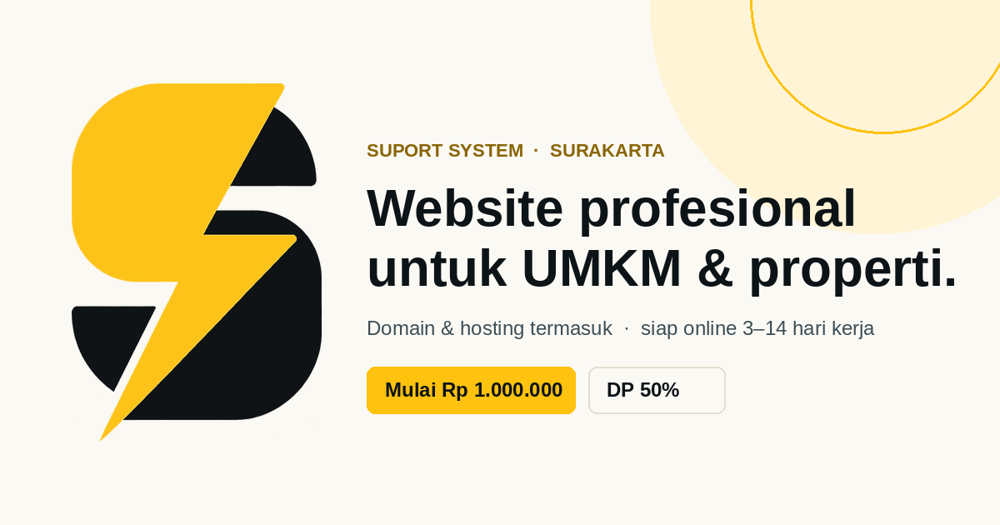

# Suport System — Website

Website layanan **jasa pembuatan website untuk UMKM & pemasaran properti** di Surakarta dan sekitarnya.
Dibangun sebagai situs statis (HTML + CSS + JavaScript murni) — tanpa framework, tanpa build step,
siap dipasang di **GitHub Pages**, Netlify, Vercel, cPanel, atau hosting apa pun.



---

## Demo & isi situs

| Bagian | Keterangan |
|---|---|
| Hero | Latar **gelap kontras tinggi** + aksen emas, *chip* keunggulan, pratinjau tampilan properti/UMKM yang bisa diganti satu klik |
| Band statistik & pita emas | Angka besar (harga mulai, waktu pengerjaan, biaya langganan **Nol**) + marquee emas |
| Manfaat | Tab **UMKM** dan **Pemasaran Properti** |
| Paket & harga | 3 paket website (Rp 1 jt / 1,5 jt / 2,5 jt) + tabel perbandingan yang bisa dibuka |
| Aplikasi siap pakai | **I-KOS** Rp 2,5 jt · **POS Rentcar** Rp 2,5 jt · **POS Dokter Gigi** Rp 4,5 jt · **Jimpitan Ronda** Rp 1 jt · **POS UMKM** Rp 1 jt · **Aplikasi custom** (online/offline, sesuai kebutuhan) — semuanya beli selamanya, tanpa biaya bulanan/tahunan |
| Pesan via WhatsApp | Setiap kartu aplikasi punya tautan pesan langsung ke WhatsApp |
| Yang Anda dapatkan | Termasuk domain & hosting, plus estimasi waktu pengerjaan |
| Cara kerja | 6 langkah |
| Pembayaran | Skema DP 50% + pelunasan, tab **GoPay** (nomor bisa disalin) dan **transfer bank** |
| Promo | Countdown otomatis sampai akhir bulan |
| Pemesanan | Formulir validasi (website **atau** aplikasi) → **invoice otomatis** (nomor invoice, rincian harga, DP 50%, nomor GoPay) → **kirim invoice ke WhatsApp** atau **cetak/simpan PDF** |
| Invoice | Nomor berurutan per hari (`INV/SS/YYYYMMDD/001`), tersimpan di `localStorage` sehingga bisa dibuka lagi lewat tombol *Lihat invoice terakhir* |
| FAQ | Akordeon 6 pertanyaan |

Fitur teknis: responsif penuh (**360 px → 1440 px**, termasuk optimasi khusus tablet),
navigasi mobile + menu geser, animasi *reveal on scroll*, `prefers-reduced-motion`,
meta SEO + JSON-LD `ProfessionalService`, dan OG image untuk pratinjau link.

**Khusus ponsel & tablet**
- *Action bar* lengket di bawah: **WhatsApp** + **Buat invoice** (selalu terjangkau ibu jari)
- Kartu aplikasi menjadi **carousel geser** (scroll-snap) dengan petunjuk geser
- Tablet 761–1024 px: paket & aplikasi tampil **2 kolom**, kartu sisa ditaruh di tengah
- Target sentuh ≥ 48 px, ukuran font input 16 px (mencegah auto-zoom iOS), dukungan `safe-area-inset`

---

## Struktur berkas

```
.
├── index.html          # halaman utama
├── css/
│   ├── styles.css      # seluruh tampilan
│   └── fonts.css       # font tertanam (Plus Jakarta Sans + Instrument Serif)
├── js/
│   └── app.js          # seluruh interaksi
├── assets/img/         # logo, favicon, og-image
├── versi-satu-file.html# versi 1 file (semua CSS/JS/gambar inline) — cadangan
├── PANDUAN-EDIT.md     # cara mengubah nomor WA, GoPay, harga, warna
├── .nojekyll           # agar GitHub Pages tidak memproses Jekyll
└── LICENSE
```

Semua tautan memakai **path relatif**, jadi bisa dijalankan dari sub-folder repo mana pun.

---

## Cara upload ke GitHub (lewat browser — tanpa install apa pun)

1. Buka <https://github.com/new>.
2. **Repository name:** `suport-system` → pilih **Public** → klik **Create repository**.
3. Pada halaman repo baru, klik **uploading an existing file**
   (atau buka tab **Add file → Upload files**).
4. Buka folder `suport-system` di komputer Anda, lalu **seret seluruh isi folder**
   (bukan foldernya) ke area upload: `index.html`, folder `css`, `js`, `assets`,
   `README.md`, `PANDUAN-EDIT.md`, `.nojekyll`, `LICENSE`.
5. Tulis pesan commit, misalnya `Website Suport System`, lalu klik **Commit changes**.

> Catatan: berkas `.nojekyll` diawali titik sehingga tersembunyi di macOS/Linux.
> Tekan `Cmd + Shift + .` (macOS) atau `Ctrl + H` (Linux/Windows) di file manager
> untuk menampilkannya. Berkas ini hanya berfungsi jika diupload; kalau terlewat,
> situs tetap jalan selama tidak ada folder berawalan garis bawah.

## Mengaktifkan GitHub Pages

1. Di repo, buka **Settings → Pages**.
2. Bagian **Build and deployment**:
   - **Source:** `Deploy from a branch`
   - **Branch:** `main` dan folder `/ (root)` → **Save**.
3. Tunggu 1–2 menit, lalu buka:
   `https://<username>.github.io/suport-system/`

**Domain sendiri (opsional):** di **Settings → Pages → Custom domain**, isi domain
Anda (mis. `suportsystem.id`), lalu arahkan DNS:
`A` record ke `185.199.108.153`, `185.199.109.153`, `185.199.110.153`, `185.199.111.153`,
atau `CNAME` `www` ke `<username>.github.io`.

---

## Cara upload lewat terminal (alternatif)

```bash
cd suport-system
git init
git add .
git commit -m "Website Suport System"
git branch -M main
git remote add origin https://github.com/<username>/suport-system.git
git push -u origin main
```

Jika `git` meminta kata sandi, gunakan **Personal Access Token** (Settings → Developer settings
→ Personal access tokens → Fine-grained token → izin `Contents: Read and write` pada repo tersebut).

---

## Mengubah isi website

- **Nomor WhatsApp:** cari `6281392399300` di `index.html` (beberapa tautan) dan `WA_NUMBER` di `js/app.js`.
- **Nomor GoPay:** cari `gopayNumber` di `index.html` (teks tampil) dan `data-copy="081392399300"`.
- **Harga & nama paket/aplikasi:** objek `PACKAGES` di bagian atas `js/app.js`
  (kunci `1`, `2`, `3` = paket website; `ik`, `rc`, `dg` = aplikasi).
  Harga yang tampil di kartu aplikasi ada di `index.html` (bagian `<section id="aplikasi">`).
- **Warna brand:** variabel `--gold`, `--ink`, `--ivory` di `css/styles.css`.
- **Teks & FAQ:** langsung di `index.html`.

Detail lengkap ada di [PANDUAN-EDIT.md](PANDUAN-EDIT.md).

> Setelah mengubah `index.html`, jalankan ulang pembuatan versi satu file bila Anda memakainya:
> `python3 build-onefile.py` (skrip opsional, lihat di bawah).

---

## Catatan

- Tidak ada data yang dikirim ke server. Formulir hanya menyusun pesan lalu membuka WhatsApp pengguna.
- Nomor rekening bank tidak ditulis di halaman; calon pembeli memintanya lewat WhatsApp agar selalu akurat.
- Logo `assets/img/logo-mark.png` berasal dari berkas logo yang diberikan pemilik usaha; versi putihnya
  (`logo-mark-white.png`) dipakai di footer. Favicon dibuat dari logo yang sama.
- Font tertanam (base64) agar tampilan identik meski tanpa koneksi ke Google Fonts.

---

## Daftar harga ringkas

| Produk | Harga | Biaya bulanan/tahunan |
|---|---|---|
| Paket 1 — Profil Bisnis / Daftar Properti Dasar | Rp 1.000.000 | Tidak ada |
| Paket 2 — Katalog Lengkap / Daftar Properti Menengah | Rp 1.500.000 | Tidak ada |
| Paket 3 — Toko Daring / Portal Properti Lengkap | Rp 2.500.000 | Tidak ada |
| APK I-KOS — Pengelolaan Kos | Rp 2.500.000 | Tidak ada (beli selamanya) |
| APK POS Rentcar — Rental Mobil | Rp 2.500.000 | Tidak ada (beli selamanya) |
| APK POS Dokter Gigi | Rp 4.500.000 | Tidak ada (beli selamanya) |
| APK Jimpitan Ronda — Kas & Ronda Warga | Rp 1.000.000 | Tidak ada (beli selamanya) |
| APK POS UMKM — Kasir UMKM | Rp 1.000.000 | Tidak ada (beli selamanya) |
| Aplikasi custom (online / offline) | sesuai kebutuhan | Tidak ada (beli selamanya) |

---

© 2026 Suport System · Surakarta, Jawa Tengah

### Formulir pemesanan — harga otomatis atau isi sendiri

| Paket dipilih | Kolom Harga | Invoice |
|---|---|---|
| Paket 1/2/3, I-KOS, Rentcar, Dokter Gigi, Jimpitan Ronda, POS UMKM | Terisi otomatis sesuai paket (tidak bisa diketik) | Memakai harga paket |
| Klik **“Ubah sendiri”** pada paket apa pun | Aktif — ketik nominal, pemisah ribuan otomatis | Memakai nominal isian, ditandai *“harga saya isi sendiri — mohon dikonfirmasi”* di pesan WhatsApp |
| **Website custom** / **Aplikasi custom** | Kosong & langsung aktif, tanpa tombol ubah | Harga dari isian; ringkasan & invoice menampilkan *“Sesuai lingkup”* bila kosong |

- Harga **wajib terisi** sebelum invoice dibuat; bila kosong muncul peringatan pada kolom harga.
- Ringkasan di samping dan **invoice otomatis** selalu mengikuti angka terakhir yang tampil di kolom Harga.
- DP 50% dan pelunasan dihitung ulang otomatis dari nominal tersebut.

### Satu invoice untuk beberapa layanan (web + aplikasi)

1. Pilih paket/layanan di **Paket yang dipilih** → klik **Tambah ke daftar pesanan**.
2. Ulangi untuk layanan lain (mis. Paket 2 website + POS UMKM + I-KOS).
3. **Daftar pesanan** menampilkan setiap item dengan label *Website / Aplikasi / Custom*, harga, dan tombol hapus (×).
4. Klik **Buat invoice & kirim via WhatsApp** → **satu nomor invoice** memuat semua baris item.

- Ringkasan di samping menampilkan rincian per item + **Total gabungan**, DP 50%, dan pelunasan.
- Label pelunasan otomatis: *“Peluncuran web & serah terima aplikasi”* bila invoice memuat web **dan** aplikasi.
- Pesan WhatsApp berisi daftar bernomor: `1. Paket 2 … — Rp 1.500.000` dst., lalu Total, DP, dan sisa.
- PDF/cetak tetap satu halaman; baris item tidak terpotong antar halaman.
- Bila daftar pesanan **kosong**, invoice hanya memuat paket yang sedang dipilih (perilaku lama).
- Invoice lama (tersimpan sebelum fitur ini) tetap bisa dibuka — otomatis tampil sebagai satu baris.

### Nomor urut pemesan (otomatis, lintas perangkat)

- Di atas formulir tampil **“Nomor urut pemesan berikutnya”**, mis. `#0004`, lengkap dengan status
  *“tersinkron online”* atau *“mode luring”*.
- Setiap kali invoice dibuat, nomor pesanan **diambil dan dikunci** untuk pesanan itu — tidak pernah sama antar pemesan.
- Nomor muncul di **kepala invoice** (`NO. PESANAN #0004`), di **catatan invoice**, dan di **pesan WhatsApp** (`No. Pesanan: #0004`).
- Kartu produk menampilkan lencana kecil **“n pesanan”** yang ikut bertambah setiap ada pesanan masuk.

**Cara kerja:** penghitung daring (abacus.jasoncameron.dev, gratis, tanpa akun) di namespace `suport-system-solo`,
kunci `pesanan-web` dan `produk-web-<id>`. Nilai tampil = nilai mentah − 1 (baseline pemasangan).
Bila internet/peramban memblokir, sistem otomatis memakai **penghitung lokal** sehingga formulir tetap berjalan.

> Catatan jujur: ini penghitung berbasis kunjungan formulir, **bukan basis data pesanan**. Bila ingin nomor urut
> resmi + rekap pesanan yang bisa Anda kelola (status DP, daftar pemesan), perlu backend —
> mis. Google Apps Script (gratis) atau Supabase. Beri tahu saya bila ingin dibuatkan.
